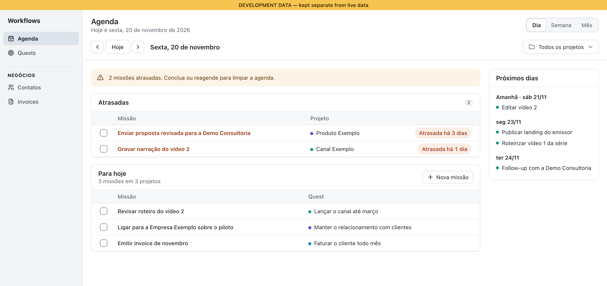

<p></p>

# Componeer

Trail UI components for Rails views, written as helpers that nest.



<sub>The dashboard from the docs' example screens (fake data). Run the docs to see the other screens and every component.</sub>

```erb
<%= page_header(title: "Quests", subtitle: "7 quests ativas em 5 projetos") do |header| %>
  <% header.with_action { button "Nova quest", variant: :primary, icon: "plus" } %>
  <% header.with_filters do %>
    <%= search_input placeholder: "Buscar quest ou missão" %>
    <%= multi_select name: :projects, label: "Projetos", icon: "folder", options: @project_options,
          all_label: "Todos os projetos", none_label: "Nenhum projeto", many_label: "%{count} projetos" %>
  <% end %>
<% end %>

<%= stack do %>
  <%= card(title: "Para hoje", subtitle: l(Date.current, format: :long)) do |today| %>
    <% today.with_action { counter @missions.size } %>
    <%= render @missions %>
  <% end %>
<% end %>
```

Every component is a [ViewComponent](https://viewcomponent.org) class exposed as a view helper. Helpers
take options and a block; blocks call more helpers, so screens are trees of components. Your own
components can be registered as helpers too.

The look comes from the **Trail UI** design system ([reference](https://claude.ai/artifact/1ZRWxLZqGKBZe9boXjcu7J)):
tokens as CSS custom properties, component classes prefixed `tr-`, Tabler outline icons.

## Installation

Componeer is not on RubyGems.org yet; install it from git.

```ruby
# Gemfile
gem "componeer", git: "https://github.com/andrerpbts/componeer.git"
```

```erb
<%# app/views/layouts/application.html.erb %>
<head>
  <%= componeer_stylesheets %>
</head>
<body class="tr-root">
  <%= app_shell do |shell| %>
    <% shell.with_sidebar(brand: "Workflows") do |sidebar| %>
      <% sidebar.with_item "Agenda", href: root_path, icon: "calendar" %>
    <% end %>
    <%= yield %>
  <% end %>
  <%= toasts %>
</body>
```

With importmap-rails and stimulus-rails the engine pins its controllers; register them once:

```js
// app/javascript/controllers/index.js
import { registerComponeer } from "componeer"
registerComponeer(application)
```

## Documentation

The gem ships its documentation as a mountable app: guides, four full example screens (list with detail,
dashboard, settings form, list with confirmation), every component with live examples and their ERB
source, options and slots, and a searchable gallery of all Tabler icons.

```ruby
# config/routes.rb
mount Componeer::Engine => "/componeer" if Rails.env.development?
```

To browse it from this repository:

```sh
bundle install
bin/rails server   # then open http://localhost:3000/componeer
```

## Components

| Group | Helpers |
|-------|---------|
| Foundations | `icon` (every Tabler icon, outline and filled: `icon "star", variant: :filled`) |
| Actions | `button`, `icon_button`, `segmented` |
| Forms | `field`, `search_input`, `toggle_switch` (+ `tr-input`, `tr-select`, `tr-check` on Rails form helpers) |
| Status | `status_dot`, `status_pill`, `counter`, `badge`, `callout` |
| Layout | `app_shell`, `sidebar`, `nav_item`, `env_banner`, `page_header`, `tabs`, `tab_panel`, `card`, `stack`, `cluster` |
| Pickers | `multi_select`, `period_picker`, `popover` |
| Data | `table`, `empty_state`, `pagination`, `code_block` (syntax highlighting with Rouge) |
| Overlays | `drawer`, `modal`, `toast`, `toasts` |

## Theming

Every colour, radius, spacing step and control size is a CSS variable. Redefine the ones you want in a
stylesheet loaded after `componeer_stylesheets`:

```css
:root {
  --accent: #6d28d9;
  --accent-dark: #5b21b6;
  --accent-soft: #f3effd;
  --radius: 6px;
}
```

The docs' Theming page shows the result live and lists every variable with what it is used for.

## Your own components

```ruby
# config/initializers/componeer.rb
Componeer.register :quest_card, "QuestCardComponent"
Componeer.configure { |config| config.icon_paths << Rails.root.join("app/assets/icons") }
```

## Development

```sh
bundle exec rspec    # specs (components, registry, icons, every docs page)
bin/rubocop          # lint
```

See [AGENTS.md](AGENTS.md) for conventions and the link to the Trail UI design system, which is the
source of truth for the look.

## License

MIT for Componeer's code. Tabler Icons (outline and filled) are MIT, © Paweł Kuna (`vendor/tabler/LICENSE`).
